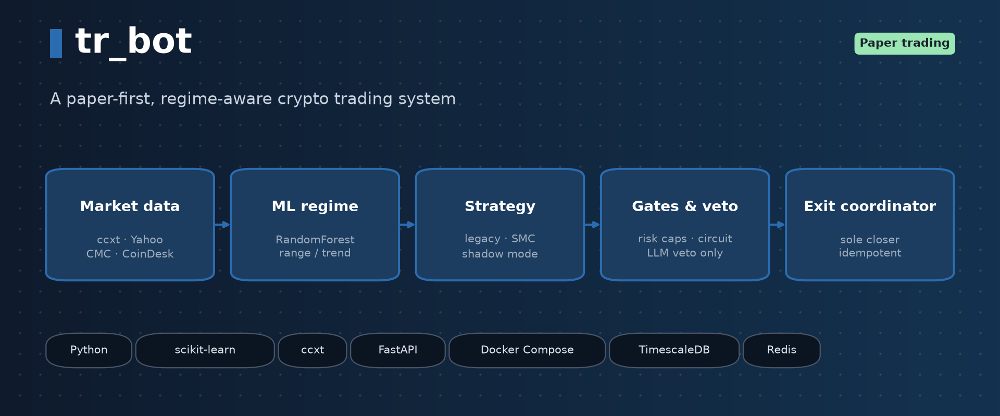
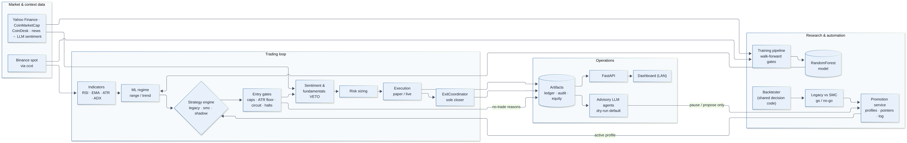
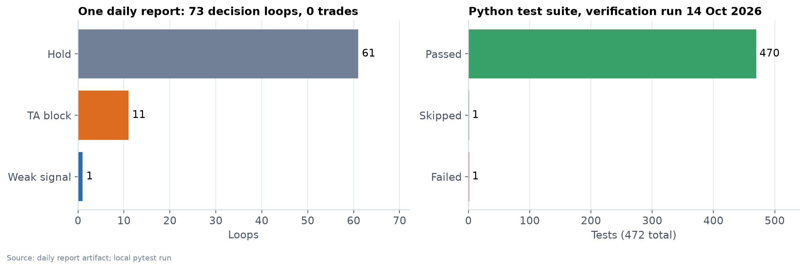
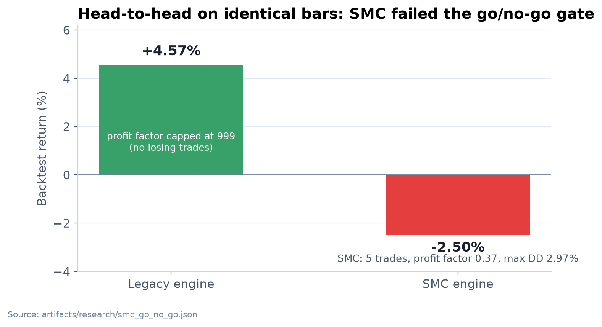
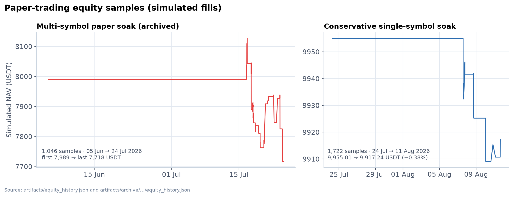

# tr_bot: building a trading system that says no

*A paper-first, regime-aware trading system for Binance spot, built around safety rails, reproducible research, and honest evaluation.*

**Python · scikit-learn · pandas · ccxt · FastAPI · Docker Compose · Redis · PostgreSQL/TimescaleDB · Chart.js**

------------------------------------------------------------------------

In a single April daily report, the bot ran 73 decision loops and placed zero trades. Sixty-one loops returned "hold." Eleven were blocked by a technical filter. One was a weak signal.

That report is the most useful artifact this project produced. It is also a failure, depending on which question you ask.

Most hobby trading bots I had seen share the same shape: a single script, a single indicator, an API key pasted into the source, and a backtest that looks brilliant right up until it meets a real market. The hard part of automated trading is rarely finding an entry signal. It's everything around the signal. How do you know the market is in a state where that signal makes sense? How do you size a position so one bad trade cannot sink the account? Who is allowed to close a position, and what happens if the network drops halfway through the close? And how do you stop yourself from promoting a strategy that only worked on the data you tuned it on?

I built tr_bot to work on those questions. It is a Python trading stack for Binance spot markets. It trades in paper mode by default, and every route to real money is opt-in and fails closed. All results below come from simulated fills and backtests, not live capital. My goal was not a money machine. I wanted something closer to a small, well-run trading desk: a clear decision hierarchy, explicit risk authority, an audit trail for every decision, and a promotion process that makes a strategy earn its way from simulation toward live capital.

## The principles that shaped the design

**Statistics choose the side; everything else can only say no.** The entry signal comes from deterministic, testable logic: an ML regime filter plus mean-reversion or trend rules, or an optional smart-money-concepts (SMC) pipeline. Large language models are in the system, but only as a veto. A news-sentiment label can block a trade; it can never open one. LLM agents that supervise the system can pause trading or propose a configuration change, but they cannot place an order.

**Fail closed, especially near money.** A live start is refused if API keys are missing, a symbol is not a valid ccxt pair, the per-trade notional cap is zero, or an unsupported exit policy is configured. In paper mode the exchange client never receives API keys at all.

**One closer.** Exactly one component, the ExitCoordinator, may submit close orders — and it records its intent before it talks to the exchange.

**Same code in research and production.** The backtester calls the same decision functions as the live loop, so a backtest measures the strategy that actually runs rather than a rewritten copy of it.

**Write down the invariants.** I kept a ~50 KB engineering handbook. For each area of the system it lists the modules that own it, the invariants that must hold, and the tests that lock them in.

## How it works

The system is a pipeline with explicit points where a trade can be stopped:

> market data → indicators → regime detection → signal → entry gates → sentiment veto → sizing → execution → exit coordination

The regime model is a scikit-learn `RandomForestClassifier` that labels the current market as *range* or *trend* from RSI, EMA20, EMA50 and ATR. Mean reversion mostly works in ranging markets, so the regime tells the engine which playbook is allowed to run. Training is its own offline pipeline: it pulls history from the exchange via ccxt, from Yahoo Finance, and optionally from CoinMarketCap and CoinDesk, then runs walk-forward `TimeSeriesSplit` validation and must pass explicit anti-overfitting gates — an out-of-fold F1 floor and a maximum train/validation accuracy gap — before a model is accepted.

On top of that legacy path I built a second engine: a ten-stage SMC pipeline. It checks higher-timeframe bias, regime suitability, market structure, liquidity, order blocks, fair-value gaps, break of structure and market structure shift, then produces a weighted composite trade score. Rather than switch to it on faith, I added a shadow mode. The bot trades the legacy strategy while evaluating SMC in parallel, logging both views side by side in the decision audit. A dedicated `backtest-compare` command runs both engines on identical bars and writes a go/no-go verdict.

## What it grew into

What started as a trading loop became an operational platform.

**Execution and exits.** The trading engine polls each symbol and applies a long list of *named* entry gates — regime confidence, signal strength, ADX filters, an ATR-vs-cost floor, cooldowns, daily caps, max open positions, circuit breaker, manual and drawdown halts, notional caps — and records why it did not trade as carefully as why it did. The exit layer is idempotent: per-symbol locks, stable client order IDs, pending state persisted before submission, partial-fill handling, startup reconciliation of in-flight exits, and a watchdog that checks stops every few seconds between strategy polls.

**Risk and capital.** Fixed-fractional sizing from stop distance (deliberately not Kelly), a consecutive-loss circuit breaker, a fund-level NAV drawdown halt, correlation/volatility/session risk multipliers clamped to a safe band, and a tiered deployment model — paper → `live_canary` → `live_full` — with hard canary caps.

**Strategy lifecycle.** Strategies are versioned profiles with a hypothesis and parent lineage. Atomic deployment pointers say which profile each tier runs. There is an append-only promotion log, gate checks on trade count, calendar days, drawdown and profit factor, plus freeze and one-command revert.

**Automation.** A hard-block startup pipeline runs preflight, then training, bounded parameter tuning and a walk-forward backtest gate; a failure at any stage keeps the trading loop from starting. A "no-trade adaptation" job notices long stretches without entries, finds the dominant blocking reason in the audit log, proposes a single bounded parameter step, and applies it only after an isolated backtest passes.

**Observability.** A FastAPI backend serves health and readiness probes, a summary API, alerts (circuit tripped, trading halted, NAV drawdown, stale heartbeat), P&L that separates TP/stop hit-rate from net-of-fees win rate, and a token-gated write API for actions like circuit reset, pause, retrain and promote. Two dashboard generations sit on top, built with Tailwind and Chart.js.

The whole thing runs as a Docker Compose stack on an always-on home server, exposed only on the LAN through a Raspberry Pi nginx reverse proxy and local DNS. Nothing is port-forwarded to the internet. In total: about 24,000 lines of Python across roughly 155 modules, with about 9,000 lines of tests.

## Challenges, and what the data told me

**The circuit breaker that froze exits.** A risk-focused review of the codebase found a serious bug. When the consecutive-loss circuit breaker tripped, the main loop broke out of symbol processing entirely — which meant it stopped managing open positions too, including their stop-losses. A control meant to limit risk was quietly increasing it. I restructured the loop so a tripped circuit, fund halt or manual halt blocks only new entries, while exits and holding snapshots keep running. "The circuit blocks entries only" is now a written invariant with tests covering the halt-vs-exit interaction.

**Fees eat small edges.** On 5-minute bars the typical ATR move was often too close to the round-trip trading cost. I wrote a fee-precedence module modelling Binance taker tiers, including a 7.5 bps BNB-discounted taker rate. I also added an ATR floor (`MIN_ATR_PCT` ≈ 0.0045, roughly 3× the round-trip cost) so the bot skips trades too small to pay for themselves. The recommended configuration moved from 5-minute to 1-hour bars, and a script now ranks candidate pairs by profit factor after costs.

**Over-filtering: a strategy too careful to trade.** Every gate I added made individual trades safer and made trading itself rarer. The adaptation state at the end of the latest paper soak counted 497 consecutive loops with no new position opened. Across July and August I ran a lineage of paper "soak" profiles, each recording its hypothesis and each relaxing exactly one cluster of filters — regime confidence from 0.70 to 0.60, then the RSI-distance threshold, then the TA filter, and finally the signal-strength filter, after I found it was blocking trend entries even at zero distance. That one-variable-at-a-time discipline is built into the tooling, and the reasoning stays readable in the artifacts.

**The new strategy didn't win, and the system said so.** I put real effort into the SMC engine. In the head-to-head comparison it returned −2.50% with a profit factor of 0.37 over 5 trades, against +4.57% for the legacy path on the same bars. The go/no-go gate failed and SMC stayed out of production. That is the outcome I built the comparator for, even if it wasn't the one I hoped for.

**Paper trading was humbling, and I kept the evidence.** An earlier multi-symbol soak ended with the simulated fund about 24% below its peak NAV, the circuit breaker tripped, and new entries blocked. Instead of hiding it, I archived the full state before narrowing the portfolio to a single symbol; a manifest records that 44 of 53 trades were dropped from the active ledger and 9 kept. I then ran a fresh, more conservative soak — 0.3% risk per trade, max 2 trades per day — which held drawdown to well under 1% over roughly the next 18 days.

**Data plumbing is half the work.** Integrating CoinDesk and CoinMarketCap surfaced the classic failure modes: database sessions dropping while a large DataFrame was being converted, sequence gaps in tick streams, ambiguous ticker symbols, API credit budgets. Each fix — build rows before connecting, chunked upserts with backoff, TCP keepalives, sequence-gap backfill, ID-based asset identity, look-ahead-safe backward `merge_asof` for macro features — is documented in the runbook.

## What I learned

**Risk engineering matters more than signal engineering.** The parts I am proudest of are not the indicators. They are the single-closer exit design, the fail-closed live validation, and the rule that halts block entries but never exits.

**Build the evaluation before you trust the strategy.** Shadow mode, the engine comparator and the promotion gates are what stopped me shipping an underperforming SMC engine on intuition.

**Gates have costs.** A filter that removes bad trades also removes good ones. Logging a reason for every non-trade turned "the bot isn't doing anything" from a mystery into a histogram I could act on.

**Backtests flatter you unless you fight them.** I made the cost model explicit, documented where live and backtest exit pricing differ, refused to publish Sharpe or Sortino below a minimum sample size, and capped profit factor when there are no losses. Each of those exists because an earlier number looked better than it deserved to.

**Write the handbook as you go.** Keeping invariants and owning modules in one document made the codebase much easier to change safely — for me, and for the AI coding assistants I worked with, which read the same skill files.

## What comes next

The immediate priority is closing the sample-size gap: running paper soaks long enough to hit the project's own progression gates — at least 120 closed trades, profit factor ≥ 1.15, net-positive after fees, drawdown ≤ 6% — before `live_canary` is even a conversation. Alongside that, three fixes matter most: retrain the regime model on the execution timeframe rather than daily Yahoo bars, replace the `close > EMA20` regime label with something forward-looking, and finish protective-order reconciliation so `EXIT_POLICY=exchange_native` can be enabled safely next to the software watchdog.

There is also a harder item on the list: the internal review recommended that "insufficient data" should fail the equity-drawdown gate rather than being treated as a skipped pass. I agree. A gate that passes when it cannot see enough is not a gate.

## Closing

> A gate that passes when it cannot see enough is not a gate.

The system is not profitable in any meaningful sense, and this essay is not evidence that it will be. What it is, is a small, well-run trading desk in miniature: one place that decides, one place that can close, a written record of every refusal, and a promotion path that a strategy has to earn. The most valuable output so far is not a return figure. It is the 73-loop report and the −2.50% go/no-go artifact, because both told me something true before real money was involved.

------------------------------------------------------------------------

Expand technical appendix

## Appendix: technical report

**Scope.** Automated trading stack for Binance spot via ccxt, with ML regime detection, legacy mean-reversion/trend and optional SMC engines, layered risk controls, strategy promotion tiers, and an operator dashboard.

**Status.** In testing (paper trading). Simulated fills only; not trading real money. Live trading is opt-in, tiered (`live_canary`, `live_full`) and fail-closed.

**Role of AI.** Random-forest regime classifier (core). Optional LLM news sentiment as veto only. Optional advisory Supervisor and Fund Manager agents, dry-run by default, never placing orders.

**Deployment.** Docker Compose on a homelab server; LAN-only dashboard via Raspberry Pi nginx and local DNS. Also runnable bare-metal via `start.sh`.

**Size and timeline.** ~24k LOC across ~155 modules (81 of them test modules), ~9k LOC of tests. Earliest artifacts late March 2026; strategy sweeps March–July 2026; paper soaks June–August 2026; code updated through October 2026.

### Stack

| Layer | Technology |
|----|----|
| Language / runtime | Python 3.12+, bash orchestration |
| Data & ML | pandas, NumPy, scikit-learn (RandomForest, TimeSeriesSplit), joblib, pyarrow/Parquet |
| Market data | ccxt (Binance spot), yfinance, CoinMarketCap API, CoinDesk API |
| LLM | OpenAI-compatible chat API (configurable base URL, e.g. xAI) |
| API / web | FastAPI, uvicorn, vanilla JS, Tailwind, Chart.js |
| Storage | JSON/JSONL artifacts, PostgreSQL/TimescaleDB, Redis |
| Observability | prometheus-client, structured logs, webhook notifications |
| Quality | pytest, Node test runner, pyright, bandit, pip-audit |

### Regime model (startup pipeline run, 17 July 2026)

| Metric | Value |
|----|----|
| Training data | Yahoo Finance daily bars, 2 years, 14 tickers |
| Rows trained | 9,760 |
| Out-of-fold F1 | 0.782 |
| Mean train/validation accuracy gap | 0.098 |
| Validation gates | Passed |

The F1 measures how well the classifier reproduces the `close > EMA20` regime label; it is not a measure of trading performance. In this run the model trained on daily bars while the backtest ran on 5-minute bars — a mismatch the runbook explicitly warns about.

### Bounded tuning + startup backtest gate (same run)

| Metric | Value |
|----|----|
| Parameter combinations evaluated | 12 (1 achieved a positive sweep score) |
| Backtest | BTC/USDT, 5m, 29,984 bars, legacy engine, 4 bps fee + 3 bps slippage |
| Trades | 1 (1 win, 0 losses) |
| Strategy return | +0.38%, max drawdown 0.00% |
| Buy-and-hold, same window | −8.96% |
| Gate result | Passed (return ≥ −5%, drawdown ≤ 12%, ≥ 1 trade) |

A single trade across ~30k bars cannot support a conclusion. The result is mainly evidence of how selective that configuration was.

### Legacy vs SMC comparison (go/no-go artifact, July 2026)

|               | Legacy                      | SMC                            |
|---------------|-----------------------------|--------------------------------|
| Return        | +4.57%                      | −2.50%                         |
| Profit factor | 999 (cap; no losing trades) | 0.37                           |
| Trades        | 3                           | 5                              |
| Max drawdown  | 0.00%                       | 2.97%                          |
| Verdict       | —                           | Not promoted (go/no-go failed) |

**Both arms sit far below the sample size this project requires before drawing conclusions. The legacy profit factor of 999 reflects zero losing trades in a small sample, not a robust edge.**

### Paper trading (simulated 10,000 USDT baseline)

| Period | Observation |
|----|----|
| Multi-symbol soak, June–24 July 2026 | NAV ended ~24.4% below peak; circuit breaker tripped, new entries blocked. State archived: 53 trades in the ledger, 9 kept for the continuing single-symbol soak (net PnL at archive: −44.99 USDT). |
| Conservative soak, 24 July–11 August 2026 (1,722 equity samples) | NAV 9,955.01 → 9,917.24 USDT (≈ −0.38%); lowest sample 9,909.13; drawdown from peak 0.38%; circuit breaker not tripped. |
| Entry frequency | 497 consecutive loops with no new position at the latest adaptation state. An April daily report showed 73 loops, 0 trades (61 hold, 11 TA block, 1 weak signal). |

The archived soak's equity samples begin on 5 June at about 7,989 USDT, already below the 10,000 baseline; the 24.4% from-peak figure comes from the fund state recorded at archive time.

### Engineering quality

| Metric | Value |
|----|----|
| Python test suite | 472 tests: 470 passed, 1 skipped (live CoinDesk integration, needs an API key), 1 failed (a test stub out of date with a new `fill_price` argument) |
| Frontend tests (Node) | 14 passed |
| Internal risk review | 1 P0 (circuit breaker froze exits), 3 P1 findings; the P0 is fixed |

### Implementation notes

**Look-ahead safety.** CoinMarketCap macro history is merged onto training bars with a backward `merge_asof`, so a bar only ever sees data published at or before its timestamp. Historical CMC calls stay off the live hot path; live snapshots are TTL-cached.

**Deterministic shared decision code.** The legacy `decision_engine`, the SMC `signal_pipeline` and the single-bar replay function are pure: no clock, network or filesystem access inside per-bar functions. The backtester calls the same generators as the live loop, and a replay-parity test guards exit price semantics.

**Exit coordination contract.** `request_exit(symbol, outcome, reason, fallback_price, execution_context)` takes per-symbol plus global locks and generates a tx + 32-hex client order ID. It persists `exit_state=pending` before the exchange call, then finalises, marks unknown, or keeps `partially_filled` based on the response. It never drops a position from memory because a request timed out. Rebalance-initiated exits (`REBALANCE_*` contexts) bypass the circuit breaker by design.

**Live-start validation.** `runtime_validation` re-checks safety at preflight and engine start, not only at import time. Live needs both key and secret, ccxt-format pairs, and `LIVE_MAX_NOTIONAL_USDT > 0`. Canary additionally needs non-empty canary symbols, a risk multiplier in (0, 0.25\] and a notional cap in (0, 50\] USDT. `EXIT_POLICY=exchange_native` is rejected until protective-order reconciliation is complete.

**Honest metrics.** Sharpe and Sortino are unpublished below 30 return observations. The code documents that its Sharpe is `(mean/std)·√n` on per-step equity returns with no risk-free rate, so it is not a textbook annualised Sharpe. Profit factor is capped at 999 when there are no losses. The dashboard separates TP/stop outcome rate from net-PnL win rate after fees.

**Bounded automation.** The parameter sweep runs walk-forward backtests as isolated subprocesses and re-runs top candidates on shorter history for a stability score. Emitted profiles go only to the paper pointer, and only after the backtest gate passes. Live pointers are never moved automatically. Adaptation takes one bounded step at a time and skips the SMC engine. The scheduler can evaluate promotion gates but never promotes.

------------------------------------------------------------------------

*tr_bot is a research and engineering project. Nothing here is financial advice, and all results above are simulated.*

