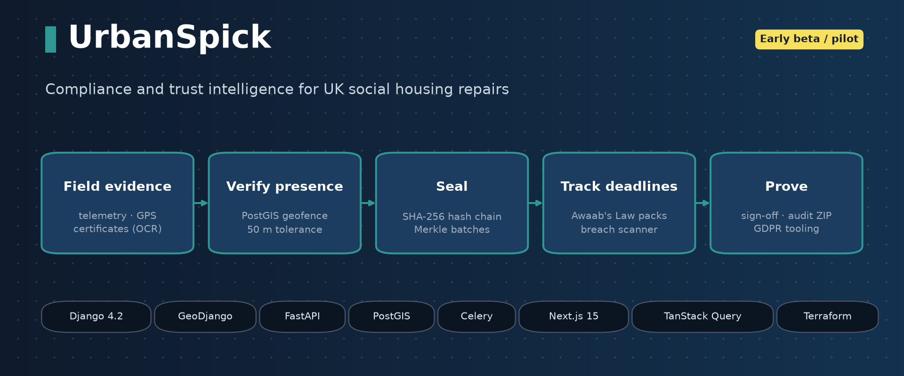
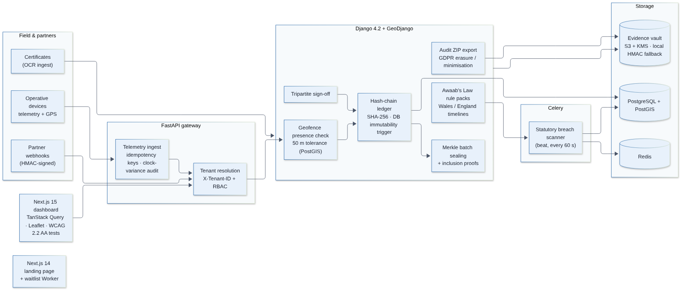
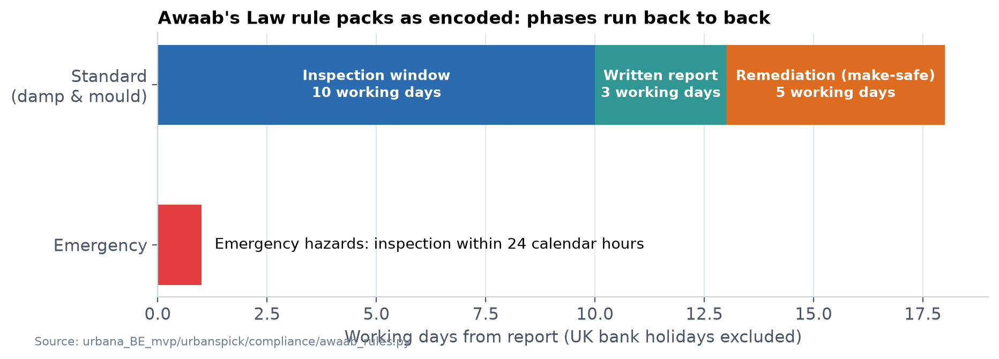
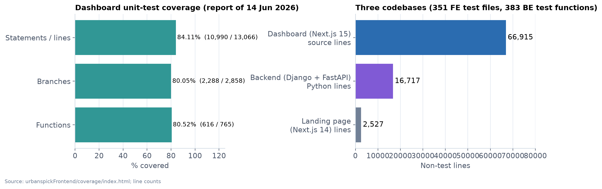

# UrbanSpick: can you prove this home is safe?

*Figure 1. The evidence path: field data is checked, sealed and tracked against statutory deadlines until it can be proven.*

A housing provider's system says a damp-and-mould repair was completed on time. A tenant says nobody came. The record is a row in a spreadsheet, edited by whoever last had access, with a photo in a shared drive that could have been taken anywhere. When a regulator, an ombudsman or a court asks what happened, the honest answer is often that nobody can prove it either way.

UrbanSpick is my attempt to make that answer provable: a compliance platform for UK housing providers that records who was on site, when, and with what evidence; seals the record so it can't be quietly changed; and tracks statutory deadlines. It is in development and not live.

Awaab's Law is named after Awaab Ishak, a two-year-old who died in 2020 from prolonged exposure to mould in his family's social-rented flat. It sets legal timeframes for investigating and fixing damp, mould and other hazards. Gas, electrical and fire-safety certificates must also be current. Most providers track all of this in spreadsheets, job-management exports and shared drives: easy to edit after the fact, hard to search, almost impossible to verify.

The project began as something else. The earliest document in the repository (August 2025) is a requirements spec for an eco-friendly cleaning marketplace under the same name. Researching that market led me to the much sharper problem of evidence in housing repairs, and I pivoted. The platform is built for Wales first, with a bilingual English/Welsh interface and Welsh rule packs, and England alongside.

## The principles that shaped the design

**Evidence before assertions.** A job is done when there is location-verified presence, time-verified telemetry and stored evidence, not when a box is ticked.

**Tamper-evident by construction.** Records join a hash chain the database itself refuses to modify.

**The law as code, with dates done properly.** Deadlines come from explicit rule packs in working days, and breaches are detected by a scheduler, not by memory.

**Tenant isolation is non-negotiable.** Each provider's data is separate, with role-based access within it.

**Privacy by design.** Housing data is personal data, so GDPR erasure, legal holds and data minimisation are core features.

**Accessible by default.** Dashboard tests include automated accessibility checks aimed at WCAG 2.2 AA, the public-sector accessibility standard.

## How it works

UrbanSpick has three codebases. The backend is a hybrid: Django 4.2 with GeoDjango provides the data model, migrations and PostGIS spatial queries, while a FastAPI application mounted through Django's ASGI entry point serves the HTTP API. Redis handles idempotency locks, caching and the Celery queue; Celery runs audits, signed webhooks, the breach scanner and data minimisation. The dashboard is a Next.js 15 app, and a small landing page with a waitlist runs on a Cloudflare Worker.

*Figure 2. Architecture. Field telemetry passes tenant resolution and a geofence check before joining the hash chain; a scheduler watches statutory deadlines.*

I built the backend in numbered phases, each with its own tests: idempotent telemetry ingestion, clock auditing, the ledger, geofencing and the evidence vault, sealing and proofs, then multi-tenancy and analytics. The housing domain came next: properties, contractors, certificates, Awaab's Law rule packs, sign-off, audit bundles and privacy tooling.

## What it grew into

**A record that even my own code can't rewrite.** Each ledger record stores the SHA-256 hash of the one before it, so changing any record breaks every later link. A PostgreSQL trigger rejects deletes and any update to chain or evidence columns, so immutability doesn't depend on application code behaving. Batches of records are sealed into Merkle trees, structures that let anyone confirm a single record belongs to a sealed batch using a short proof, without seeing the rest. An API returns those inclusion proofs for external verification.

**Presence is checked, not asserted.** Field devices post events with an idempotency key, and a Redis lock ensures a retried upload is recorded once. Each event carries device, hardware and server timestamps, and the variance between them is audited, so a back-dated event stands out. PostGIS checks that a reported position is within 50 metres of the property. Photos and documents go to an encrypted S3 evidence vault.

**Statutory deadlines are computed, then watched.** For significant damp and mould, the rule packs encode a 10-working-day investigation, then 3 working days for a written summary, then 5 working days to make safe; emergencies get 24 calendar hours. A Celery task scans for breaches every 60 seconds and raises notifications. A tenant's region and organisation type decide which duties apply.

*Figure 3. The damp-and-mould phases run back to back: 18 working days (≈ 3.5 calendar weeks) from trigger to make-safe, excluding weekends and bank holidays.*

**The dashboard leads with risk, not records.** The bilingual dashboard has 13 areas, from properties and certificates to audit and reports, built around one rule: every screen starts with risk scores, deadlines and missing evidence. A tripartite sign-off (housing officer, contractor and an independent advocate) checks for missing or duplicate signers, and one click exports an audit bundle.

## Challenges, and what the data told me

**Working days are harder than they look.** The law counts working days: skip weekends and UK bank holidays, start the day after the trigger, and begin each phase when the previous one ends. I implemented this once, as a single function used by every rule pack, with tests around holiday boundaries. One simplification is visible in the code and matters: Scotland and Northern Ireland currently fall back to the England rule pack. That needs legal review before any provider there relies on it.

**Tamper-evidence has to survive its author.** A hash chain proves nothing if the application can quietly rewrite history. Putting the immutability rule in a database trigger means even a bug or a careless migration can't edit a sealed record without the break showing. For the same reason, sign-off is a desk attestation that can never mark presence as verified as a side effect.

****Some features sound finished and aren't.** Settlement anchoring (publishing batch roots to an external ledger) and cross-node sealing exist as tested code paths, but the external endpoint is a placeholder and there is no production cluster. The landing page carried an early-customer-outcomes section that nothing in the repository supported. I removed it in October 2026, because in a compliance product an unsupported number is a liability, not a placeholder. I treat those figures as placeholders and don't repeat them.

**Backend tests are written, but I couldn't run them.** The backend has 383 test functions in 66 files. I never stood up PostGIS in the environment I was working in, so those tests have never run. That is a gap I own, not a limitation of the tests — and it is the first engineering item on the list below.

A pivot also leaves fossils: the repository still opens with the cleaning-marketplace spec.

*Figure 4. The dashboard's recorded coverage report is the strongest quality evidence: just over 84% of lines and 80% of branches. The backend's tests are not reflected here.*

## What I learned

**Choose the problem, then the product.** A crowded marketplace idea gave way to a narrow, regulated problem where careful engineering matters.

**Cryptography is the easy part of trust.** Hash chains and Merkle proofs are a few hundred lines. Deciding what to seal, when, and how a non-technical inspector verifies it is the real product.

**Encode the law explicitly and test the calendar.** Statutory timelines belong in versioned rule packs, not scattered date arithmetic.

**In a compliance product, overstatement is itself a risk.** Placeholders must be labelled as placeholders, in code and in marketing.

**Accessibility and bilingual support are architecture.** Building them in from the start was far cheaper than retrofitting.

## What comes next

Housekeeping comes first. The repository's root README still describes the cleaning marketplace and needs replacing with the current product description, with the old spec archived.

On the engineering side, the backend's 383 tests need to run in CI against PostGIS, with coverage published alongside the dashboard's. Settlement anchoring needs a decision: either target a verifiable public timestamping service or remove the feature until a customer needs it. Geofencing needs field tests in high-density housing, where a 50-metre tolerance may be too generous or too strict.

The harder items need outside help. The rule packs need legal review, including whether Scotland and Northern Ireland need their own rather than falling back to England's. And UrbanSpick needs a pilot with one housing provider, with success metrics agreed in advance: evidence completeness, deadline breaches caught, and time taken to produce an audit pack. Without that, the platform's central claim, that it makes compliance provable, remains untested.

## The technical half is provable. The human half isn't yet.

The question that started this project, whether a landlord can prove a home is safe, has a technical half and a human half. UrbanSpick addresses the technical half: evidence that is located, timed, sealed and tied to a deadline. The human half, whether housing officers, contractors and inspectors find it usable and trustworthy, can only be answered by a pilot, and that hasn't happened yet.

------------------------------------------------------------------------

Expand technical appendix

## Appendix: technical report

**Scope.** Compliance and trust-intelligence platform for UK housing providers: verified field telemetry, geofenced presence, a hash-chain ledger with Merkle proofs, an evidence vault, Awaab's Law deadline tracking, certificates, sign-off, audit exports and GDPR tooling; plus a bilingual Next.js dashboard and a landing page with a waitlist.

**Status.** In development; not live. Early prototype. The dashboard describes itself as an early-stage beta for approved pilot organisations; there is no evidence of pilot users or outcomes. Settlement anchoring targets a placeholder endpoint.

**Deployment.** Docker Compose for development and a blue/green production layout with nginx; Terraform for an API-only AWS ECS deployment; landing page on a Cloudflare Worker. No production environment.

**Size and timeline.** Backend ~16.7k lines of Python (excluding migrations and tests); dashboard ~66.9k lines of TS/TSX; landing page ~2.5k lines. Original cleaning-marketplace spec August 2025; backend docs June 2026; dashboard coverage report 14 June 2026.

### Stack

| Layer | Technology |
| --- | --- |
| Backend | Python, Django 4.2, GeoDjango, FastAPI (ASGI), Celery (worker and beat) |
| Data | PostgreSQL with PostGIS, Redis |
| Integrity | SHA-256 hash chain, database triggers, Merkle trees, HMAC-signed webhooks, AWS S3 with KMS |
| Dashboard | Next.js 15, TypeScript, TanStack Query, Zustand, Leaflet, recharts, jsPDF, i18next (English/Welsh), Mock Service Worker |
| Testing | pytest (needs PostGIS), Vitest with vitest-axe |
| Landing page | Next.js 14 static export, Tailwind, Cloudflare Worker |
| Infrastructure | Docker Compose (blue/green nginx), Terraform for API-only AWS ECS, Prometheus |

### Key metrics

| Metric | Value |
| --- | --- |
| Dashboard coverage (14 Jun 2026, 222 source files measured) | Lines 84.11% (10,990 / 13,066); branches 80.05% (2,288 / 2,858); functions 80.52% (616 / 765) |
| Dashboard test files | 351 (Vitest suite; separate from the 222 measured source files) |
| Backend tests | 383 functions in 66 files (not run: need PostGIS) |

| Rule pack (Wales and England) | Phases |
| --- | --- |
| Significant damp and mould | Investigation 10 working days → written summary 3 → make safe 5 |
| Emergency | Inspection within 24 calendar hours |
| Breach scanner / data minimisation | Every 60 seconds / daily |

The rule packs reflect my reading of the regulations and have not been legally reviewed.

### Full feature list

- Idempotent telemetry ingestion with Redis locks; device, hardware and server clock-variance audit.
- Hash-chain ledger with an immutability trigger (later narrowed so workflow status fields can change); Merkle sealing; inclusion-proof API; optional settlement anchoring to a configurable placeholder endpoint.
- PostGIS geofence (50 m); S3/KMS evidence vault with a local HMAC-signed fallback for development; certificate ingestion with OCR.
- Awaab's Law rule packs; breach notifications; contractor management with SLA tracking; tripartite sign-off; audit ZIP export.
- Multi-tenancy via an `X-Tenant-ID` header checked against a tenant registry; role-based access; tenant settings for region, organisation type and locale.
- GDPR erasure from redaction requests, legal holds that block erasure, daily data minimisation, client action audit logging.
- PostGIS area analytics and portfolio intelligence; health diagnostics, cluster heartbeats, Prometheus metrics.
- Dashboard areas: dashboard, properties, compliance, evidence, certificates, actions, operations, audit, reports, health, organisation, admin, access-blocked.

### Glossary

- **Awaab's Law:** UK legislation setting timeframes for social landlords to investigate and fix damp, mould and other hazards.
- **Geofence:** a geographic boundary used to check whether a device is at a location.
- **Hash chain:** a sequence of records where each stores a cryptographic hash of the previous one, so edits are detectable.
- **Idempotency key:** a unique tag that makes a retried request take effect only once.
- **Merkle tree / inclusion proof:** a hash structure that lets a single record be proven part of a batch with a short list of hashes.
- **PostGIS:** the spatial extension for PostgreSQL.
- **WCAG 2.2 AA:** the web accessibility standard commonly required in the public sector.

*UrbanSpick is an early-stage product. Nothing here is legal advice; the statutory timelines are as implemented in code, not an authoritative statement of the law.*

